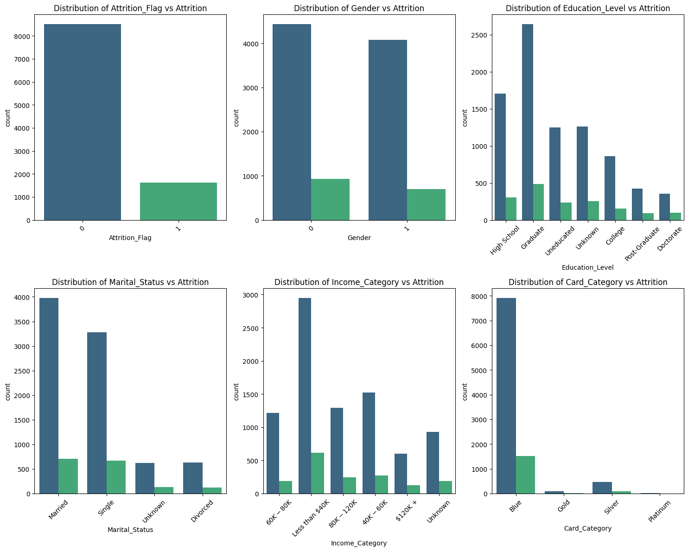
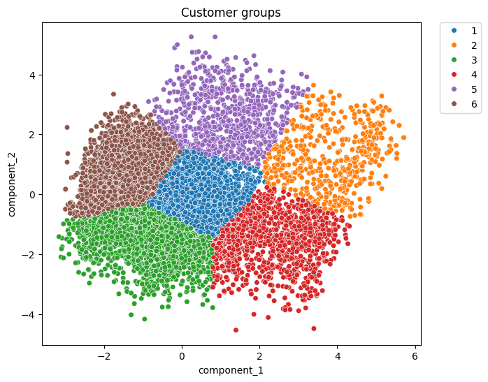
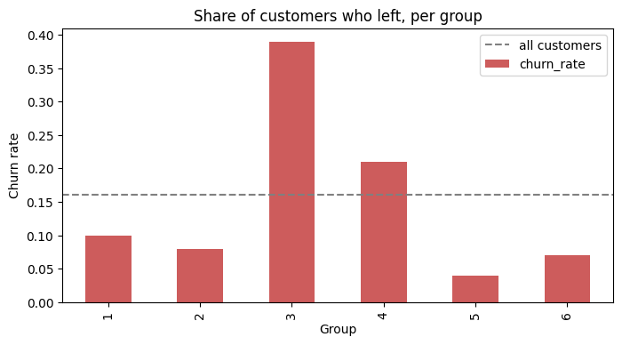
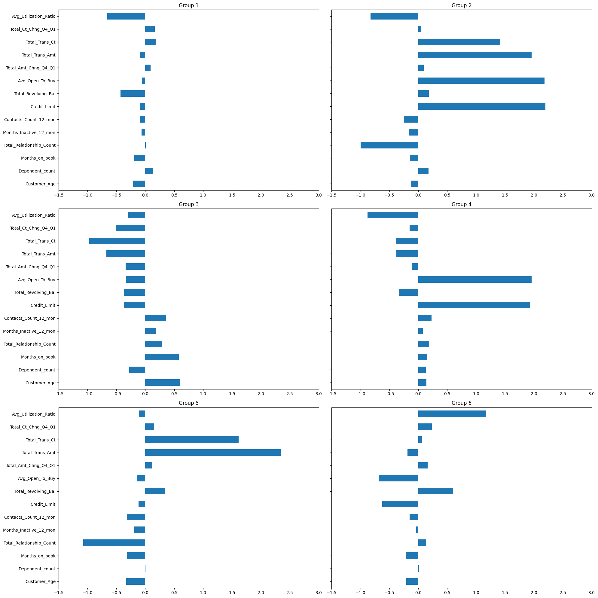

# Credit Card Customer Churn

A bank was losing credit card customers and wanted to know who is likely to leave next, so it could try to keep them. We used the [Credit Card Customers dataset from Kaggle](https://www.kaggle.com/datasets/sakshigoyal7/credit-card-customers) (about 10,000 customers) to:

1. predict which customers will churn
2. group customers into segments to understand who the churners are

This was a 5-day team project at BeCode, together with Yusra Ali, Yeliz Kaya and Maarten Warnez.

## The data

Each row is a customer, with information like age, income, card type, credit limit, number of transactions and months of inactivity. Only around 16% of the customers left, so the data is quite imbalanced. That was the main challenge: a model that just says "nobody leaves" would already be 84% accurate and completely useless.

## What we did

- Cleaned the data and one-hot encoded the categorical columns (education, income, marital status, card type)
- Split the data into train and test first, so the test set is never used for any decision
- Picked the most useful features with an Extra Trees model (training data only)
- Put scaling, SMOTE and the model in one pipeline, so SMOTE only balances the training folds during cross-validation
- Trained 5 models and compared them with 5-fold cross-validation, choosing the best one on churn F1
- Used PCA + K-Means to split the customers into 6 groups

## Results

Test set: 2,532 customers, 407 of them churned.

| Model | Accuracy | Churn precision | Churn recall |
|---|---|---|---|
| Random Forest | 0.96 | 0.85 | 0.88 |
| Decision Tree | 0.94 | 0.79 | 0.86 |
| KNN | 0.88 | 0.60 | 0.84 |
| Logistic Regression | 0.84 | 0.51 | 0.79 |
| Naive Bayes | 0.79 | 0.41 | 0.73 |

Random Forest worked best. It found 358 of the 407 customers who left. I focused on recall because for the bank, missing a customer who is about to leave is worse than calling someone who was going to stay anyway.







## What we found

- Demographics don't explain much. Around 15-17% of both men and women left, and the churn rate looks about the same across education levels, income groups and card types.
- One segment stands out: in Group 3 roughly 4 out of 10 customers left, while in most other groups it was about 1 in 10.
- What makes Group 3 different is **low card use**: about 42 transactions a year, the lowest of all groups (most groups have 55–100).
- This holds in the whole dataset too. Customers with 60 or fewer transactions a year left in 32–37% of cases; above 80 transactions, almost nobody left (under 2%).
- The number of products matters as well: customers with only 1 or 2 products left in about 26–28% of cases, against 11–12% for those with 4 or more.

So instead of targeting customers by age or income, the bank should watch how actively they use the card. A drop in transactions is the clearest early warning. Contacting those customers, and offering a second product to people who only have one or two, could be a cheap way to keep them.

## Update after the project

When I reviewed the code later, I found and fixed three problems:

- **Data leakage in feature selection.** Features were picked using all the data, including the test set. Now they are picked on the training data only.
- **SMOTE before cross-validation.** Synthetic samples leaked into the validation folds and made the cross-validation scores too optimistic. SMOTE now runs inside a pipeline.
- **Mixed cluster labels.** The churn charts and the group profiles came from two different K-Means runs, so "Group 3" did not mean the same customers in both. All charts now use one clustering. This changed one conclusion: the high-churn group is defined by low card use, not by having few products.

## My part

I took care of the data preparation: cleaning the data, one-hot encoding the categorical columns (education, income, marital status, card type) and picking the most useful features with an Extra Trees model.

## Files

- `Main/classifiying.ipynb`: the final models
- `Main/clustering.ipynb`: the customer segments
- `cleaned_data/`: cleaning notebook and the cleaned csv
- the folders with our names: each person's own exploration

## Run it

```
pip install -r requirements.txt
jupyter notebook Main/classifiying.ipynb
```
