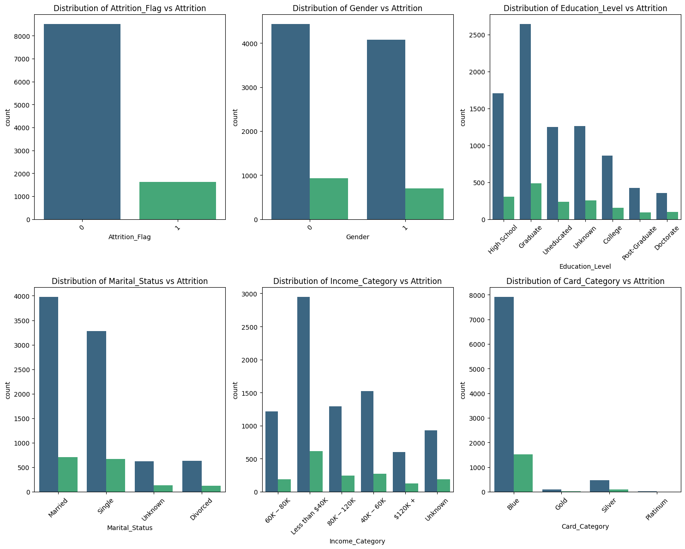
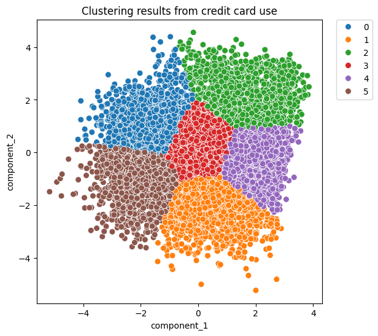
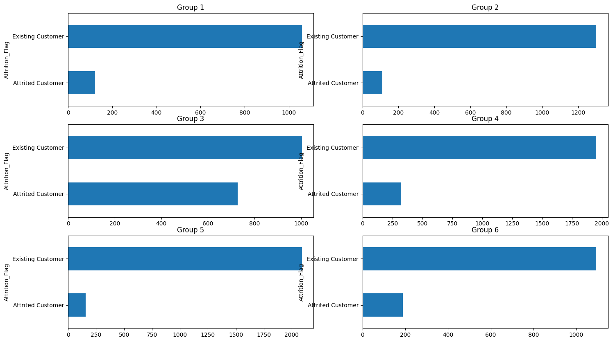
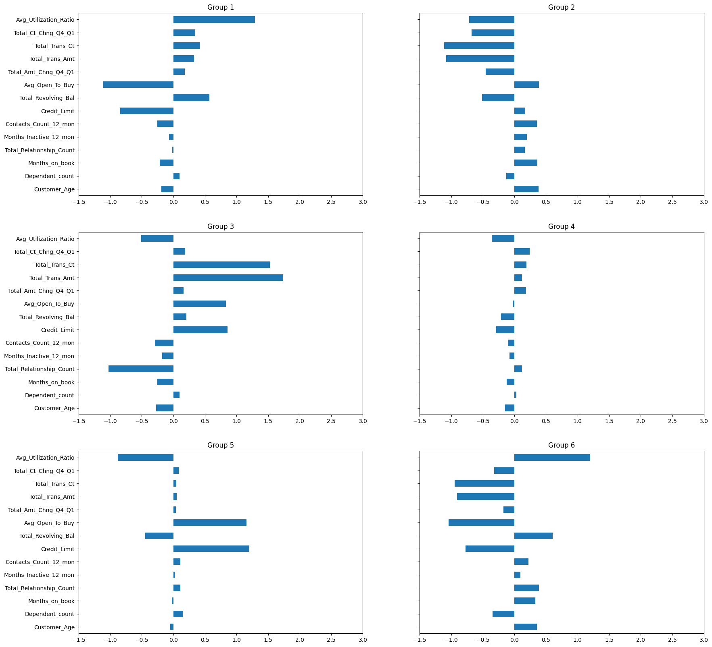

# Credit Card Customer Churn

A bank was losing credit card customers and wanted to know who is likely to leave next, so it could try to keep them. We used the [Credit Card Customers dataset from Kaggle](https://www.kaggle.com/datasets/sakshigoyal7/credit-card-customers) (about 10,000 customers) to:

1. predict which customers will churn
2. group customers into segments to understand who the churners are

This was a 5-day team project at BeCode, together with Yusra Ali, Yeliz Kaya and Maarten Warnez.

## The data

Each row is a customer, with information like age, income, card type, credit limit, number of transactions and months of inactivity. Only around 16% of the customers left, so the data is quite imbalanced. That was the main challenge: a model that just says "nobody leaves" would already be 84% accurate and completely useless.

## What we did

- Cleaned the data and one-hot encoded the categorical columns (education, income, marital status, card type)
- Picked the most useful features with an Extra Trees model
- Used SMOTE on the training data to balance the two classes
- Trained 5 models and compared them with 5-fold cross-validation
- Used PCA + K-Means to split the customers into 6 groups

## Results

Test set: 2,532 customers, 407 of them churned.

| Model | Accuracy | Churn precision | Churn recall |
|---|---|---|---|
| Random Forest | 0.96 | 0.85 | 0.88 |
| Decision Tree | 0.94 | 0.79 | 0.86 |
| KNN | 0.88 | 0.60 | 0.84 |
| Logistic Regression | 0.84 | 0.51 | 0.79 |
| Naive Bayes | 0.79 | 0.41 | 0.73 |

Random Forest worked best. It found 358 of the 407 customers who left. I focused on recall because for the bank, missing a customer who is about to leave is worse than calling someone who was going to stay anyway.







## What we found

- Demographics don't explain much. Around 15-17% of both men and women left, and the churn rate looks about the same across education levels, income groups and card types.
- One segment stands out: in Group 3 roughly 4 out of 10 customers left, while in most other groups it was about 1 in 10.
- Group 3 customers have the fewest products with the bank (low `Total_Relationship_Count`). People who only use one or two of the bank's products seem much easier to lose.

So instead of targeting customers by age or income, the bank should look at how connected they are. Offering a second product (a savings account, an app feature, a better card) to customers with only one or two products could be a cheap way to keep them.

## My part

I took care of the data preparation: cleaning the data, one-hot encoding the categorical columns (education, income, marital status, card type) and picking the most useful features with an Extra Trees model.

## Files

- `Main/classifiying.ipynb`: the final models
- `Main/clustering.ipynb`: the customer segments
- `cleaned_data/`: cleaning notebook and the cleaned csv
- the folders with our names: each person's own exploration

## Run it

```
pip install pandas numpy scikit-learn imbalanced-learn matplotlib seaborn jupyter
jupyter notebook Main/classifiying.ipynb
```
